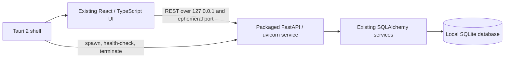

# Architecture

## Product and Module Boundaries

The product is **Music Program Scheduler**. Startup opens the product-level dashboard for the active Scheduling Session; session actions live there. A built-in module registry routes into each module's own shell and navigation. Accompanist Scheduling is the first functional module. Its import, pianist availability, assignment, and report views remain inside that module. Clinical Placements is currently an implementation-pending shell; its approved workflow and domain/optimizer contract are documented in [CLINICAL-PLACEMENT-MODULE-SPEC.md](CLINICAL-PLACEMENT-MODULE-SPEC.md). Jury setup/readiness, backend schedule generation, and a read-only Schedule view backed by typed current/history APIs are implemented; manual schedule editing and finalization remain out of scope.

Academic terms, small people identities, time primitives, locations, and useful file/import infrastructure may be shared when actual reuse is demonstrated. Lesson requirements, pianist availability and workload, accompanist assignment scoring, jury rules, and clinical placement constraints remain module-owned. The accompanist optimizer is not a universal scheduling engine.

## Transitional Desktop Runtime

The desktop runtime uses Tauri 2. During development Rust starts `desktop_server.py` with the backend virtualenv (or the configured Python interpreter); production starts the bundled PyInstaller service. Scheduling, imports, reports, and SQLite remain in Python. This is a transitional runtime, not the intended long-term application boundary.

The service binds only to `127.0.0.1`. Tauri reserves an ephemeral port, passes it to the service, waits for `/api/health`, and exposes `http://127.0.0.1:<port>` to React through the narrow `get_api_base` Tauri command. `src/lib/platform.ts` is the only frontend module that detects Tauri or invokes that command. Browser development continues to use `VITE_API_BASE`, then the legacy `apiBase` query parameter, then `http://localhost:8123`.

FastAPI CORS allows only the Vite development origins, the Tauri WebView origins (`tauri://localhost` and `http://tauri.localhost`), and the retained Electron build's opaque `null` file origin. Credentials are not enabled; only the API methods and `Content-Type` header used by the app are allowed. CORS does not expose the service beyond its loopback listener.

The service's database path is set to Tauri's per-user application-data directory as `pianist_scheduling.db`. No data is uploaded or synchronized with remote services.

## SQLite Schema Migrations

The schema version is stored in SQLite's built-in `PRAGMA user_version`; the current supported schema version is **10**. Version 0 is the implicit pre-framework baseline and is classified as either a new empty database or a recognized legacy Accompanist schema. Version 1 is the released Accompanist baseline. Version 2 adds Scheduling Session metadata. Version 3 adds an Accompanist-specific weekly submission-completeness marker. Version 4 adds shared UUID identities, Accompanist lesson/pianist identity mappings, conflict evidence, and module revision state. Version 5 adds the typed module result registry and dependency records. Version 6 adds Jury configuration, lesson entries, Panels, and date-scoped pianist availability. Version 7 adds Accompanist-owned lesson-level Jury Required values, defaulting existing lessons to false, and retires contract-v1 snapshots from current use while preserving their history. Version 8 adds a per-Panel date extension and backfills existing Panels from the former session-wide Jury Date. Version 9 adds an editable, case-insensitively unique Accompanist Pianist ID, backfilled from each existing numeric Pianist primary key. Version 10 adds module-owned Clinical Placement tables (tags, Placement Opportunities, students and recurring Availability Windows, student tag states, placements) and a per-session Clinical module state row; it has no foreign keys to other modules. A database advertising a higher version is rejected without downgrade or schema changes.

The application-owned ordered `MIGRATIONS` registry and runner live in `webapp/backend/app/database.py`. `init_db()` migrates the active engine; `migrate_database(engine)` accepts any SQLite SQLAlchemy engine so a future Session restore can migrate a staged database before activation. Migration versions start at 1, run sequentially, and are not skipped.

Each upgrade runs under SQLite `BEGIN IMMEDIATE`; schema/data changes and the `user_version` update commit in the same transaction. A failure rolls back and raises `DatabaseMigrationError` with a stable `code` and readable message. Startup does not continue as if migration succeeded. Version 1 creates the original Accompanist schema and absorbs the recognized legacy `lessons.teacher_email` and `lessons.student_id` column additions. Version 2 adds `scheduling_sessions` and one neutral “Legacy Session / Music Program / Term not set” row. Version 3 adds `pianist_availability_states`. Version 4 assigns random Person UUIDs to pianist and student identities, stable Lesson UUIDs, and flags materially conflicting names for repeated nonblank Student IDs; blank-ID lessons remain distinct. Version 5 adds typed result envelopes and dependency provenance. Version 6 adds Jury-owned inputs and initializes empty Jury configuration. Version 7 creates the Accompanist-owned per-lesson Jury Required extension with false defaults and invalidates contract-v1 current pointers without deleting historical snapshots. Version 8 creates `jury_panel_dates`, backfilling from the former session-wide date while preserving the released v6 Panel table shape. Version 9 adds and backfills `pianists.pianist_code` and its case-insensitive uniqueness index. Version 10 creates the `clinical_*` tables and one `clinical_module_states` row per existing session. Current-version opens validate the Accompanist and module schemas but do not call `create_all`, seed data, or modify domain rows. Unknown tables, malformed known tables, corrupt databases, and newer schema versions fail safely.

To add a schema change, add the next consecutively numbered `SchemaMigration` to `MIGRATIONS` and implement its forward `upgrade(connection)` function. Do not edit a released migration or add startup column checks. There are no down migrations. New module tables use separate SQLAlchemy metadata so the released Accompanist v1-v3 table definitions remain unchanged. Migration tests and the synthetic legacy fixture are in `webapp/backend/tests/test_database_migrations.py` and `webapp/backend/tests/fixtures/legacy_accompanist_v0.sql`; run them with `npm test`.

`.mpsession` Open/Restore extracts to a staged database, calls `migrate_database(staged_engine)`, validates it, and only then activates it. The migration runner does not create backups or own replacement UX.

On Unix the service is launched in a dedicated process group, which is terminated on exit so PyInstaller one-file workers cannot survive their parent. On Windows Tauri invokes the fixed system `taskkill.exe /PID <pid> /T /F` operation to terminate the child tree, with direct-child termination as a fallback. Tauri then waits for the child. Startup failure also terminates the child before returning an error. Unix process-group termination was smoke-tested with the packaged service; Windows tree termination still needs a native Windows validation run.

## Platform Abstraction

React's API client depends on `getApiBase()` in `src/lib/platform.ts`. The Tauri adapter obtains the endpoint from a Rust command. Browser builds retain their existing environment/query configuration. No Tauri APIs are called from React pages or components.

The main-window capability grants only dialog open/save and filesystem read/write operations for paths selected by those dialogs. There is no shell, opener, updater, or generic filesystem access exposed to the frontend. Session archives and the synthetic Accompanist availability CSV template use the platform file service: Tauri uses a native Save dialog and writes only to the selected path; browser mode uses a local save picker or download. The custom endpoint command is registered by the Rust application.

## Scheduling Sessions and Portable Archives

One `scheduling_sessions` row describes the active SQLite database: application-generated UUID, institution/program display names, term label, optional year and dates, and created/modified timestamps. There is no `session_id` foreign key across Accompanist tables and no in-app history library. New Session builds an empty current-schema database beside the active file, creates a recovery archive first, then atomically replaces the active database.

Archive format version 1 is a ZIP-compatible `.mpsession` containing only `manifest.json` and `data/session.sqlite3`. The manifest identifies the archive contract, application version, session display metadata, export timestamp, actual database schema version, and payload SHA-256. Archive format and SQLite schema versions are independent: table/schema evolution uses SQLite migrations; archive format changes only when the container or manifest contract changes. Export uses SQLite's online backup API and normalizes the resulting snapshot to a standalone DELETE-journal database, including current WAL state.

Restore rejects malformed, oversized, duplicate, unexpected, encrypted, path-traversing, checksum-mismatched, incompatible, or corrupt input. It stages the fixed database payload in a private temporary directory, checks SQLite integrity and the actual schema version, migrates and validates metadata there, then creates a recovery archive and atomically replaces the active database. Any failure before replacement leaves the active session unchanged.

Automatic recovery archives are valid `.mpsession` files under the active database's `recovery/` directory (Tauri: the per-user application-data directory). Retention is the latest three snapshots. They are distinct from user-exported files and are not shown in a session history UI. Archives are unencrypted and may contain student educational information; users must store and transfer them under institutional policy. The application does not upload session data.

## Dialog Conventions

Every modal dialog dismisses through the shared `.dialog-close` control (defined in `App.css`): a 36px bordered square containing `×`, placed at the right of the dialog heading, with an `aria-label` such as "Close". Do not use text-link "Close" buttons or module-specific close styles. Footer buttons such as Cancel or Done are separate from this control.

Row-level delete actions in tables and lists use one shared control: `danger-btn small` containing `×`, with a `title` and an `aria-label` naming the item (for example "Delete Synthetic Clinic"). This applies to Lesson Roster rows, Pianists, Jury Panels, Jury Availability Windows, Clinical Placement Opportunities, and Clinical Tags. Do not use text "Delete" or "Remove" buttons for single-row deletion. Bulk actions such as "Delete all lessons" remain labeled danger buttons, and every deletion still goes through its module's existing confirmation. Edit actions stay as separate text buttons with spacing from the delete control.

## Shared Availability and Import

`AvailabilityWindow` is a shared value with weekday, start/end minute, status (`Available`, `Tentative`, or `Unavailable`), and optional in-memory import row provenance. It accepts ranges and multiple windows per day; it does not own an optimizer, person table, or UI policy. Submission completeness is separate from status: absent windows are unknown for an incomplete horizon and derive Unavailable for a valid complete horizon. Same-status overlapping/adjacent ranges merge. Conflicting overlaps are errors. Time/day parsing is shared; Tentative scoring remains Accompanist-specific.

The local tabular reader supports CSV, XLSX, and XLS (via `xlrd`). The availability workflow maps either normalized one-window-per-row columns or configurable wide respondent columns, previews rows, and blocks apply on any error. Pianists are matched by exact case-insensitive display name because the current Accompanist profile has no stable import identifier. Unknown and duplicate-name matches are rejected; the importer never creates or merges pianists.

The Accompanist adapter accepts only range boundaries aligned to its existing 30-minute slots; it rejects other boundaries instead of rounding. Version 3's completeness marker declares the pianist's full weekly horizon. Imports persist sparse Available/Tentative slots; absence in a complete horizon derives Unavailable, and the existing solver continues to return no fit for those slots. Incomplete or invalid imports never set completeness or mutate slots. `.mpsession` remains archive format 1.

Each accepted submission completely replaces the weekly availability of every matched pianist; pianists absent from the file remain unchanged. Blank days/times in a structurally complete response mean no availability. A named normalized row with blank window cells is a valid zero-window week; a wide response must map every weekday. Missing mappings, malformed rows, or invalid times block the entire apply. Manual edits are ordinary slot data; re-import warns that all availability for matched pianists, including manual edits, will be replaced. Import provenance and edit-since-import detection are not persisted.

Microsoft Forms is a collection/export workflow only: coordinators may ask for a respondent name and one or more available day/time ranges, export responses to Excel, then inspect/map/review them locally. There is no Forms API, Graph integration, authentication, callback, or remote workbook upload.

## Privacy and Network

Project and scheduling data remain local. App traffic is React-to-FastAPI HTTP on loopback, including selected workbook bytes sent only to the local service for parsing. There are no telemetry, analytics, cloud, licensing, or remote-service integrations. Tauri does not open a LAN listener. Future location/travel scoring and other module-specific algorithms remain out of scope.

## Shared Report Export

Report pages render a single `ReportExportButton` (`webapp/frontend/src/components/ReportExport.tsx`) that opens the shared Export dialog. `reportExportService` (`lib/reportExport.ts`) owns the format list (PDF, Markdown, Excel Workbook, CSV), filename/extension selection from the report title, and dispatch to the platform `saveBinaryFile`/`saveTextFile` helpers; adding a format is one registry entry. Everything is built locally; nothing is sent to a server.

Modules own report definitions and supply `{ reportId, title, payload }`. The payload carries two module-built parts:

- **Presentation (PDF and Markdown):** the module's Markdown, plus optional PDF page-break headings. These formats show only what the report presents.
- **Data table (CSV and Excel Workbook):** a `ReportTable` (`lib/reportTable.ts`) holding the generated schedule or roster itself: **all of the fields (every column) shown on the module's Schedule/Roster view, one row per record**, with the same column names and order as that view. It is not a projection of the Markdown/PDF presentation. Each module builds its own table; the shared service only writes it (`lib/xlsxWriter.ts` for `.xlsx`, `tableToCsv` for `.csv`). Cells keep their types (numbers stay numeric in Excel; booleans export as Yes/No), and times use the same 12-hour format as the view. In addition to the view's columns, each row includes the per-student/per-lesson fields that can vary from record to record (for example teacher and pianist emails, student IDs, site contact details). Module setup data that is not per-record, such as Jury Panel settings and individual pianists' availability, is excluded, as are internal identifiers (database ids, UUIDs).

Source view per module:

| Module | Source view | Table |
|---|---|---|
| Accompanist Scheduling | Lesson Roster (Schedule tab) | `accompanistReportTable.ts`: Day, Start, End, Teacher, Teacher Email, Student, Student ID, Room, Instrument, Needs pianist?, Jury required?, Specific pianist, Assigned pianist, Assigned pianist Email, Hours, Fit, Manually Edited, Notes |
| Performance Jury Scheduling | Schedule tab | `juryReportTable.ts`: every Panel entry (juries and breaks) plus unscheduled lessons, with Panel, Jury Date, Start, End, Student / entry, Instrument, Instructor, Assigned Pianist, Pianist Required, Status, Reason, Explanation |
| Clinical Placements | Schedule tab (Placements and Unplaced Students) | `clinicalReportTable.ts`: Student, Student ID, Student Email, Placement Site, Site Address, Contact Name/Email/Phone, Opportunity Label, Tags, Day, Start Time, End Time, Session Length, Travel, Placement Type, Preferred Tag Matches, Tentative Minutes, Status, Warnings, Unplaced Reason |
| Lesson Scheduling, Tutor Scheduling (planned) | Schedule tab | Same rule: all fields of the module's Schedule tab |

When a module's Schedule/Roster view gains or changes a column, its table and table test must change with it.

### Saved Reports and Stale Warning

A generated report persists in the active session so it reappears when the Reports tab is reopened, including after the application is closed and reopened.

- Storage: the `saved_reports` table (migration v11), one row per session and module (`accompanists`, `jury`, `clinical`; future modules add their own id). It holds the Markdown, page-break headings, and export table (see above) plus an opaque `source_stamp`. API: `GET`/`PUT /api/reports/saved/{module_id}`. Generating again replaces the previous row.
- Shared client code: `useSavedReport` (`lib/savedReport.ts`) and `StaleReportBanner`. Modules supply only a source-state function returning `{ stamp, sourceStale }` and the report builder; the backend does not interpret the stamp.
- Staleness: a report is stale when the current stamp differs from the saved one or the module's source result is itself flagged stale. An amber warning is shown at the top of the Reports page. The stamp is read before report data is fetched, so a concurrent edit can only make a report look stale, never wrongly fresh.

| Module | Stamp | Also stale when |
|--------|-------|-----------------|
| Accompanist Scheduling | `source_revision` from the finalization state | — |
| Performance Jury Scheduling | current Jury result UUID | the current result is flagged stale |
| Clinical Placement Scheduling | `schedule_revision:source_data_revision` | the schedule is flagged stale |

Saved reports contain student information. They remain in the local session database, are included in `.mpsession` archives and recovery snapshots, and are never sent to a remote service.
